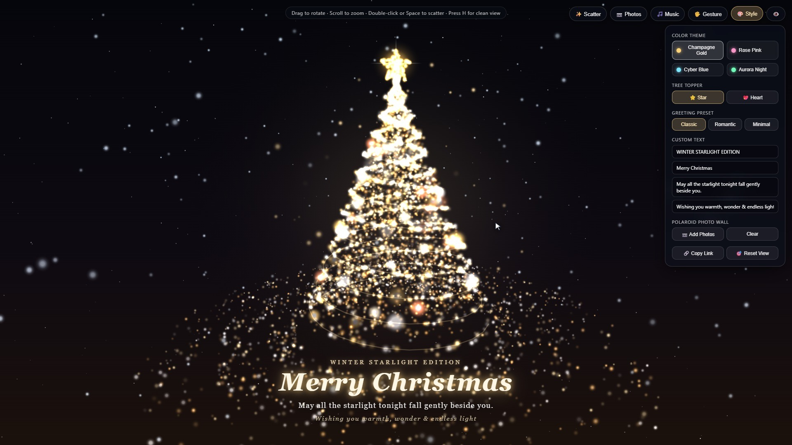

# Interactive 3D Particle Christmas Tree

A zero-dependency, single-file HTML5 Canvas 3D particle Christmas tree with multi-theme glow palettes, Star/Heart topper switching, nebula scatter physics, Polaroid photo wall, synthesized Web Audio music box, and optional MediaPipe hand gesture control.



## Features

- **Pure HTML5 / Canvas 3D Engine**: Pre-rendered radial glow sprites with additive blending (`lighter`) running smoothly at 60 FPS with zero external 3D library dependencies.
- **4 Color Themes**:
  - **Champagne Gold** (`gold`)
  - **Rose Pink** (`pink`)
  - **Cyber Blue** (`cyber`)
  - **Aurora Night** (`aurora`)
- **Switchable Tree Toppers**: Toggle between a **5-Pointed Star** (with cross-flare lens rays) and a **Glowing 3D Heart**.
- **Nebula Scatter & Reform**: Double-click, press `Space`, click `Scatter`, or open your palm in gesture mode to explode the tree into a swirling galaxy and reform it back.
- **Polaroid Photo Wall**: Upload local photos to hang as 3D Polaroid frames spiraling around the tree; click any frame (or pinch in gesture mode) to zoom in.
- **Built-in Music Box**: Synthesized polyphonic Web Audio API bell melody (*We Wish You a Merry Christmas* + *Jingle Bells*) with zero external audio files.
- **Optional Hand Gesture Control**: Uses MediaPipe Hands (loaded on demand) to scatter/gather (`Open Palm` / `Fist`), rotate (`Hand X`), and zoom photos (`Pinch`).
- **Shareable URL Parameters**: Customize defaults via query string, e.g.:
  `?theme=pink&top=heart&title=Merry%20Christmas`

## Quick Start

### Option 1: Open Locally
Simply open `index.html` in any modern desktop or mobile browser.

### Option 2: Run Local Server (Required for Camera Gesture Control)
Browsers require `localhost` or `https://` for webcam access:

```bash
python -m http.server 8080
```

Then visit `http://localhost:8080`.

### Option 3: GitHub Pages
Enable **Settings -> Pages -> Deploy from branch (`main` / `/ (root)`)** to get a free `https://` link where camera gesture control also works on mobile and desktop browsers.

## Controls

| Action | Control |
| --- | --- |
| Rotate 3D Tree | Drag with mouse / touch |
| Zoom In / Out | Scroll wheel / pinch |
| Scatter / Reform Nebula | Double-click / `Space` / `Scatter` button |
| Clean Recording Mode | Press `H` or click the eye icon (`👁️`) |
| Hand Gestures | Open palm (scatter), Fist (gather), Move left/right (rotate), Pinch (zoom photo) |

## License

MIT License. See [LICENSE](./LICENSE).
